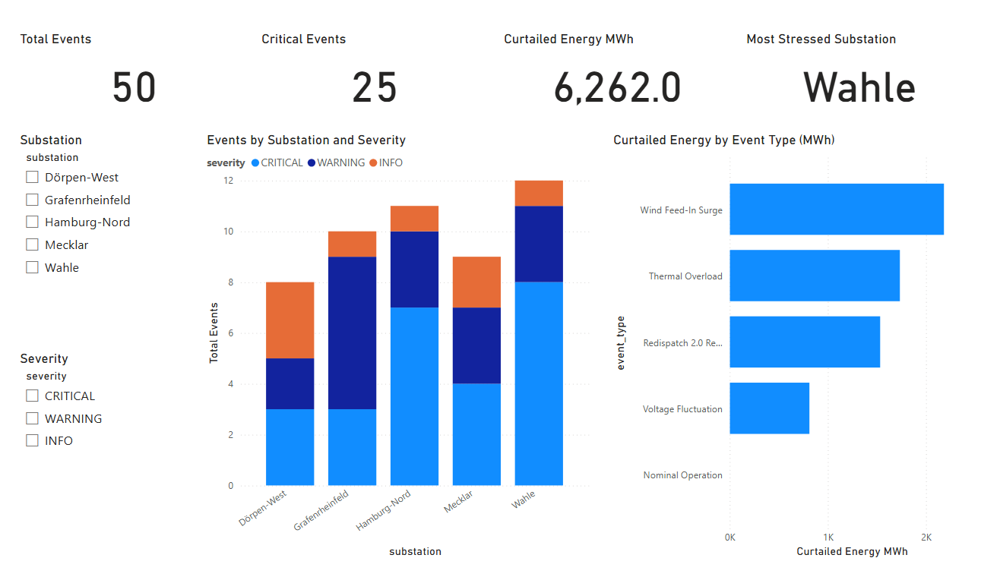
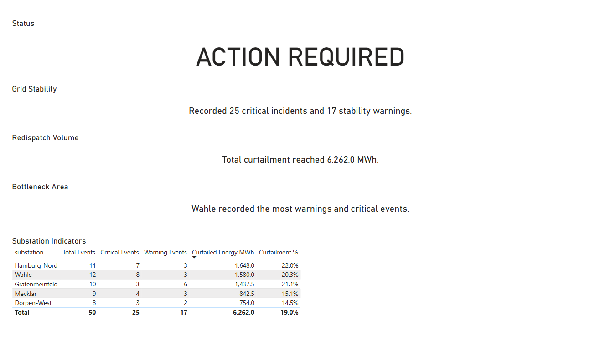
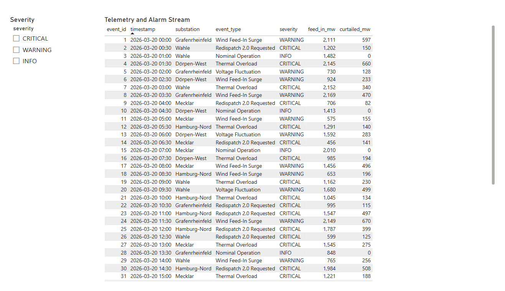
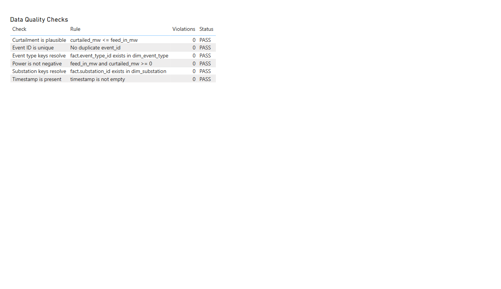

# Grid Incident Reporting: Power BI version

A Power BI rebuild of the Streamlit portal in this repo, on a star schema
(`fact_events` + `dim_substation`, `dim_event_type`) exported by `python -m data.export_powerbi`.
The event log is **synthetic** (50 events at 30-minute intervals).

| Layer | What it contains |
|---|---|
| **Power Query (M)** | One reusable `GetCsv` function, a `DataBaseUrl` parameter, typed columns and a `dq_checks` query |
| **Data model** | Two one-to-many relationships, severity sorted by rank |
| **DAX** | 13 measures: event counts, curtailed energy, and a rule-based executive briefing |
| **Report** | Operations Overview, Executive Briefing, Event Log, Data Quality |

The briefing page follows the rule-based summary in `report_generator.py` in shorter wording.
The optional LLM summary and the Markdown download are not part of the Power BI version.

## Open it

1. Use a current version of Power BI Desktop (tested with 2.160, November 2026, with no preview
   settings changed). An older version may need the Power BI Project (.pbip), TMDL and PBIR preview
   features switched on under File, Options and settings, Options, Preview features.
2. Open `Grid_Incidents.pbip`.
3. A PBIP stores no data, so click **Refresh**. When asked how to connect to
   `raw.githubusercontent.com`, choose **Anonymous**. The default address reads the files on the `main` branch.
   If Power BI then asks for **privacy levels**, choose **Public** (the data is public and synthetic)
   and click **Save**.
4. To load local files instead: Home, Transform data, Manage parameters, set `DataBaseUrl`
   to the full path of `data\\processed` in your clone.
5. Save as `.pbix` (File, Save as) if you want a single file to share or publish.

If the project will not open, use `fallback/`: create a blank report, paste each query from
`PowerQuery_queries.m` (create `DataBaseUrl` as a text parameter first), set the relationships,
then paste the measures from `DAX_measures.dax`.

## Expected figures (no filters)

**50** events, **25** critical, **17** warnings, curtailed energy **6,262.0 MWh** (**19.0%** of feed-in),
status **ACTION REQUIRED**, most stressed substation **Wahle**.

| Substation | Events | Critical | Warnings | Curtailed MWh | Curtailment % |
|---|---|---|---|---|---|
| Hamburg-Nord | 11 | 7 | 3 | 1,648.0 | 22.0% |
| Wahle | 12 | 8 | 3 | 1,580.0 | 20.3% |
| Grafenrheinfeld | 10 | 3 | 6 | 1,437.5 | 21.1% |
| Mecklar | 9 | 4 | 3 | 842.5 | 15.1% |
| Dörpen-West | 8 | 3 | 2 | 754.0 | 14.5% |

All six data-quality checks should show PASS.

## Verification

Tested in Power BI Desktop 2.160 on Windows: the project opens, refreshes from GitHub, all 13
measures evaluate without errors, every data-quality check passes, and the figures queried from the loaded
model match an independent calculation in pandas. The screenshots below come from that run.

`tests/test_powerbi.py` checks the files' consistency on every CI run; it does not start Power BI.

## Screenshots

**Operations Overview**

**Executive Briefing**

**Event Log**

**Data Quality**

