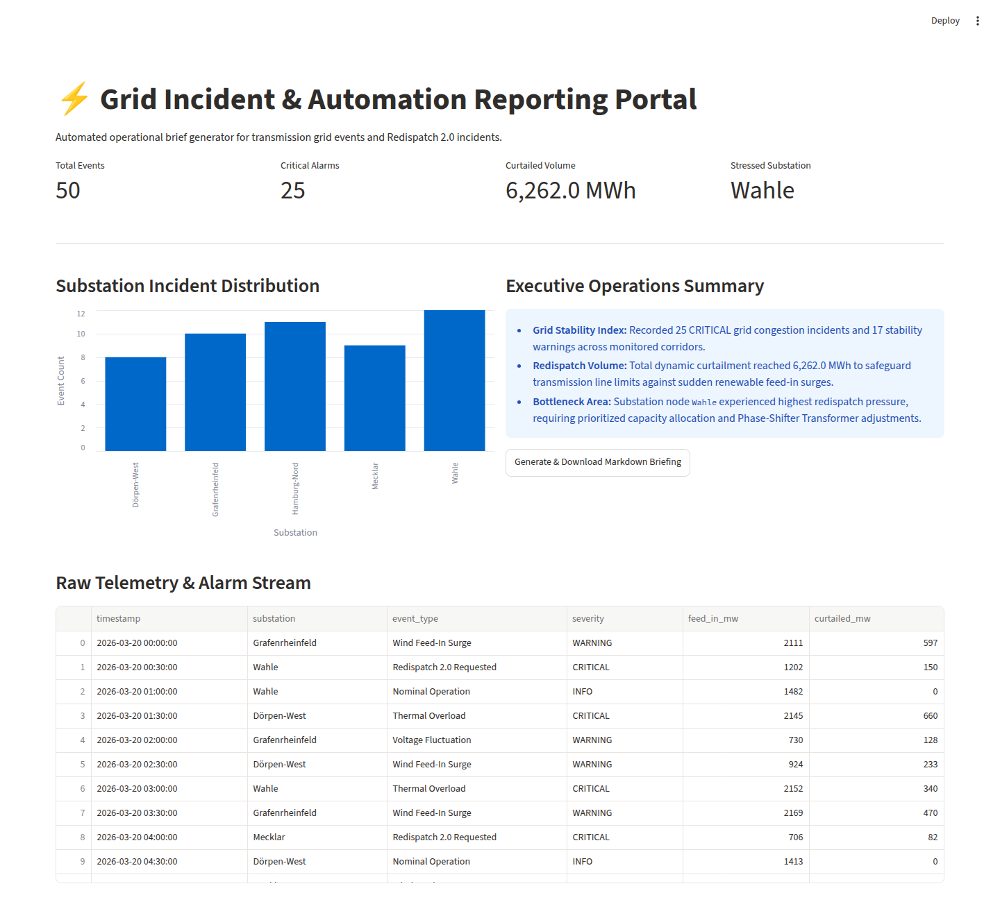

# 📝 Automated Grid Incident Reporting

[](https://grid-incident-reporting.streamlit.app/)  
**Live demo:** https://grid-incident-reporting.streamlit.app/

Turns raw grid event logs into a **management-ready briefing** automatically: load and validate the data, compute KPIs, write an executive summary (optionally with an LLM), and export a Markdown report. Includes a **Streamlit** portal for interactive use.

> The event logs are **synthetic** (50 seeded grid events across five substations), generated automatically on first run.



## ⚙️ How It Works

```
data/sample_generator.py   synthetic event log (CSV)
        │
        ▼
report_generator.py        load + schema check → KPIs → executive summary → Markdown report
        │
        ├──► output/executive_briefing.md
        └──► app.py        Streamlit portal (KPIs, charts, download button)
```

| Step | What happens |
|---|---|
| **Load & validate** | Reads the event log and checks that required columns exist |
| **KPIs** | Total events, critical alarms, warnings, curtailed energy (MWh), most stressed substation |
| **Summary** | If `OPENAI_API_KEY` is set, an LLM writes the executive bullet points; otherwise a rule-based template is used, so the tool always works offline |
| **Report** | Markdown briefing with status badge, KPI table and the top critical events |

See [`output/executive_briefing.md`](output/executive_briefing.md) for an example report.

## 📈 Power BI Version

[`GridIncidents_PowerBI/`](GridIncidents_PowerBI/) rebuilds the analysis as a Power BI Project (`.pbip`):

- **Data model:** event fact table with substation and event type dimensions
- **DAX:** 13 measures covering event counts, curtailed energy and an executive briefing
- **Report:** Operations Overview, Executive Briefing, Event Log, Data Quality

Open `Grid_Incidents.pbip` in Power BI Desktop and click **Refresh**. See the
[Power BI guide](GridIncidents_PowerBI/README.md) for setup, expected figures and verification status.
The committed CSVs in `data/processed/` can be rebuilt with `python -m data.export_powerbi`.

## 🚀 Quickstart

```bash
python -m venv venv
source venv/bin/activate          # Windows: venv\Scripts\activate
pip install -r requirements.txt

# generate a Markdown briefing
python report_generator.py --output output/executive_briefing.md

# or open the interactive portal
streamlit run app.py
```

Optional: `export OPENAI_API_KEY=...` to let an LLM write the summary.

Or run the dashboard with Docker, then open http://localhost:8501:

```bash
docker build -t grid-reporting .
docker run --rm -p 8501:8501 grid-reporting
```

## 🧪 Tests

```bash
pip install pytest
python -m pytest tests/
```

GitHub Actions runs the tests on pushes and pull requests to `main`.

## 🛠️ Tech Stack

Python · Pandas · Streamlit · OpenAI API (optional) · Markdown reporting · Power BI (DAX, Power Query) · Docker · pytest

## 📄 License

[MIT](LICENSE)
